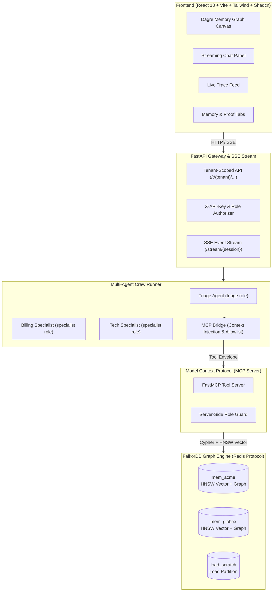

# SwarmGraph Memory Fabric: Multi-Agent Shared Memory & Coordination on FalkorDB

[](https://github.com/HelixAthu/Agent-Memory-and-Coordination/actions)
[](LICENSE)
[](#hackathon-track)

> **SwarmGraph Memory Fabric** is a production-grade shared memory and multi-agent coordination infrastructure built on **FalkorDB**, exposed to autonomous agent swarms through the **Model Context Protocol (MCP)**. It solves context amnesia, evolving semantic facts, procedural learning, and atomic multi-agent handoffs with hard tenant isolation.

---

## 1. Why the Graph is Load-Bearing

| Capability | How FalkorDB Does It | Why a Flat Store or Plain Vector DB Fails |
|---|---|---|
| **Hybrid Recall** | Vector index finds seed candidates; graph traversal (`[:MENTIONS]` entities) pulls related episodes that pure vector search missed. | Pure vector search cannot traverse shared entities; requires a second retrieval system and fragile join logic. |
| **Memory That Changes Over Time** | `[:SUPERSEDES]` chains preserve full provenance and audit history while serving only `ACTIVE` facts to LLM agents. | Overwriting rows destroys temporal auditability; append-only stores cannot answer "what was true then" cheaply. |
| **Procedural Learning** | Promotion rule aggregates distinct users over `[:APPLIED]` edges with one Cypher query (`Q-PROC-PROMOTABLE`). | Requires complex distributed joins across session logs, user profiles, and outcome tables. |
| **Agent Handoffs** | Traversal bundles 8 context items (episodes, facts, procedures, history) stored as atomic `[:CARRIES]` edges. | Chat history dumps blow up agent context windows; lossy LLM summaries drop critical structured attributes. |
| **Routing** | Load-aware match over `[:EXPERT_IN]` and active `[:CLAIMED]` tasks executed in a single atomic query. | Requires a separate distributed job scheduler, message broker, and lock manager. |
| **Tenant Isolation** | Physical graph per tenant (`mem_<tenant_id>`): zero possibility of cross-tenant query leaks. | Row-level tenant filters (`WHERE tenant_id = ?`) can be bypassed by prompt injection or missing filters. |
| **Coordination State** | In-graph conditional writes (`SET ... WHERE version = expected`) serve as atomic locks and Compare-And-Set (CAS). | Requires maintaining a separate Redis cluster with distributed lock management (Redlock). |

---

## 2. Architecture



---

## 3. Graph Data Model

### Node Types

| Label | Purpose | Key Properties |
|---|---|---|
| `User` | Customer / user identity | `id, name` |
| `Agent` | Autonomous agent crew member | `id, name, role ('triage'\|'specialist'), status` |
| `Entity` | Domain knowledge nodes | `id, name, type ('topic'\|'product'\|'invoice'), keywords` |
| `Session` | Conversation boundary | `id, user_id, status ('OPEN'\|'CLOSED'), started_at, msg_count` |
| `Message` | Ordered message chain | `id, session_id, seq, role ('user'\|'agent'), agent_id, text, ts` |
| `Episode` | Episodic memory record | `id, summary, outcome, importance, ts, status, embedding` |
| `Fact` | Semantic memory unit | `id, predicate, object, confidence, status, valid_from, valid_to` |
| `Procedure` | Procedural workflows | `id, name, trigger, steps, status ('ACTIVE'\|'CANDIDATE'\|'DEPRECATED')` |
| `Task` | Shared work queue items | `id, title, status ('OPEN'\|'CLAIMED'\|'DONE'), priority, claimed_by, version` |
| `Handoff` | Inter-agent delegation | `id, status ('PENDING'\|'ACCEPTED'\|'COMPLETED'), reason, version` |
| `StateEntry` | Coordination CAS state | `id, key, value, version, updated_by, updated_at` |

### Relationship Topology

```
(User)-[:HAD_SESSION]->(Session)-[:HAS_MESSAGE]->(Message)-[:NEXT]->(Message)
(Session)-[:SUMMARIZED_AS]->(Episode)-[:ABOUT]->(User)
(Episode)-[:MENTIONS]->(Entity)
(Episode)-[:INVOLVED]->(Agent)
(User)-[:HAS_FACT]->(Fact)-[:SUPERSEDES]->(Fact)
(Fact)-[:DERIVED_FROM]->(Session)
(Session)-[:APPLIED {outcome}]->(Procedure)
(Agent)-[:EXPERT_IN]->(Entity)
(Agent)-[:HANDED_OFF]->(Handoff)-[:TO]->(Agent)
(Handoff)-[:CARRIES]->(Fact|Episode|Procedure|Message)
(Session)-[:HAS_STATE]->(StateEntry)
```

---

## 4. Memory Types

1. **Episodic Memory**: Past interactions summarized upon session closure. Stored as `Episode` nodes with 4096-dimensional vectors. Retrieved via hybrid scoring combining vector cosine similarity, recency decay, base importance, and shared entity boosts. Stale low-importance episodes decay to `ARCHIVED` automatically.
2. **Semantic Memory**: Discrete user attributes (e.g. `plan = Pro`, `city = Mumbai`). Stored as `Fact` nodes. When user attributes evolve, the old fact transitions to `SUPERSEDED` with `valid_to = now`, while the new fact links to it via `[:SUPERSEDES]`. Repeated observations reinforce confidence (+0.05 up to 1.0).
3. **Procedural Memory**: Operating runbooks with structured trigger criteria and action steps. Stored as `Procedure` nodes. New workflows begin as `CANDIDATE`. When successfully applied across $\ge 2$ distinct users and $\ge 2$ sessions, they are promoted to `ACTIVE`. Procedures with poor success rates decay to `DEPRECATED`.

---

## 5. Load-Bearing Queries & Algorithms

Full query specifications with parameters and golden outputs are in [docs/queries.md](docs/queries.md). The five core queries underpinning system behavior:

### 1. Hybrid Recall: Candidate Vector Search (`Q-EP-VEC`)
```cypher
CALL db.idx.vector.queryNodes('Episode', 'embedding', $k, vecf32($qv)) YIELD node
MATCH (u:User {id:$uid})<-[:ABOUT]-(node)
WHERE node.status = 'ACTIVE'
RETURN node.id AS id, node.summary AS summary, node.importance AS importance, node.ts AS ts, node.embedding AS emb
```

### 2. Hybrid Recall: Entity Graph Hop (`Q-EP-RELATED`)
```cypher
MATCH (u:User {id:$uid})<-[:ABOUT]-(o:Episode {status:'ACTIVE'})-[:MENTIONS]->(x:Entity)
WHERE x.id IN $entities AND NOT o.id IN $exclude
RETURN o.id AS id, o.summary AS summary, o.importance AS importance, o.ts AS ts, o.embedding AS emb, collect(DISTINCT x.id) AS via
```

### 3. Fact Supersession & Audit Invalidation (`Q-FACT-CLOSE-OLD`)
```cypher
MATCH (old:Fact {id:$old_id, status:'ACTIVE'})
SET old.status = 'SUPERSEDED', old.valid_to = $ts
RETURN old.id AS id
```

### 4. Procedural Promotion Aggregation (`Q-PROC-PROMOTABLE`)
```cypher
MATCH (p:Procedure {status:'CANDIDATE'})
OPTIONAL MATCH (s:Session)-[a:APPLIED {outcome:'success'}]->(p)
WITH p, count(a) AS successes, count(DISTINCT s.user_id) AS users
WHERE successes >= $min_successes AND users >= $min_users
RETURN p.id AS id, successes, users
```

### 5. Work Stealing: Atomic Priority Task Claim (`Q-TASK-CLAIM-NEXT`)
```cypher
MATCH (t:Task {status:'OPEN'})
WITH t ORDER BY t.priority DESC, t.created_at ASC, t.id ASC LIMIT 1
SET t.status = 'CLAIMED', t.claimed_by = $agent, t.version = t.version + 1
RETURN t.id AS id, t.title AS title, t.version AS version
```

---

## 6. Multi-Tenancy & Security Isolation

- **Partitioned Graphs**: Every tenant has an isolated graph key (`mem_acme`, `mem_globex`). No query syntax exists that can bridge databases.
- **Context Injection**: Tenant, user, agent, and session IDs are injected server-side by the `MCPBridge`. Any LLM tool arguments attempting to spoof `tenant_id` are dropped with an emitted warning.
- **Role Allowlists**: Enforced on the server inside MCP tools. A triage agent attempting to call `accept_handoff` receives `FORBIDDEN`.
- **API Key Scoping**: `/t/{tenant}/...` endpoints require matching `X-API-Key`. Cross-tenant requests return HTTP 403 Forbidden.

---

## 7. Concurrency Model & Load Test Invariants

All mutating operations run under atomic Cypher write transactions. Verified by high-concurrency benchmarks (`scripts/load_test.py`):

| Invariant | Description | Benchmark Result | Status |
|---|---|---|---|
| **C1** | Single-task claim race (50 concurrent workers) | Exactly 1 claim won, 49 `CONFLICT` | ✅ PASS |
| **C2** | Work stealing (200 tasks across 20 workers) | 200 tasks claimed, 0 duplicates | ✅ PASS |
| **C3** | CAS counter (20 workers x 10 increments) | Counter reached exactly 200 | ✅ PASS |
| **C4** | Cross-tenant concurrent load | Parallel execution on 2 graphs with zero leakage | ✅ PASS |
| **C5** | Mixed 100 recalls + 50 message appends | Zero failed queries; unique seq numbering | ✅ PASS |

* **Throughput:** 190.2 ops/s (1400 ops in 7.36s) on standard single-node FalkorDB.
* **Latency:** Write p50: 5.5 ms, Read p50: 52.5 ms. See [evals/load_results.md](evals/load_results.md) for full distribution.

---

## 8. MCP Tools Catalog

The FalkorDB memory layer exposes 10 structured tools over MCP:

| Tool Name | Allowed Roles | Description |
|---|---|---|
| `recall_memory` | `triage`, `specialist` | Hybrid vector + graph recall for user context |
| `get_user_profile` | `triage`, `specialist` | Fetches active user facts and profile |
| `find_procedure` | `triage`, `specialist` | Searches candidate and active procedures |
| `record_procedure_outcome` | `specialist` | Records application success or failure |
| `route_to_specialist` | `triage` | Load-balanced specialist discovery by topic |
| `create_handoff` | `triage` | Bundles 8 context items into pending handoff |
| `get_pending_handoffs` | `specialist` | Inspects incoming handoff queue |
| `accept_handoff` | `specialist` | Atomically accepts a pending handoff |
| `complete_handoff` | `specialist` | Marks handoff resolved with outcome summary |
| `append_message` | `triage`, `specialist` | Appends conversation turn to persistent chain |

---

## 9. Quickstart & Setup

### Prerequisites
- Docker & Docker Compose
- Python 3.11+ with `uv` or virtualenv
- Node.js 18+ & npm

```bash
# 1. Clone repository
git clone https://github.com/HelixAthu/Agent-Memory-and-Coordination.git
cd Agent-Memory-and-Coordination

# 2. Start FalkorDB and seed demo data
make up
make seed

# 3. Run full test suite
make test

# 4. Run evaluations
make eval

# 5. Start API Gateway and UI
make dev
```

* **Backend API:** `http://localhost:8000`
* **Frontend UI:** `http://localhost:5173`

---

## 10. Demo Scenarios

1. **Continuity (`user-priya`)**: Priya returns asking about a duplicate charge. Triage recalls her August duplicate charge on invoice INV-1042, her Pro plan, and routes to Billing with 8 carried context items. Billing accepts, executes the refund procedure, and consolidates the episode.
2. **Fact Update (`user-priya`)**: Priya updates her city to Pune and prefers chat. Old facts fade to grey in the graph, new facts slide in with `[:SUPERSEDES]` relationships, preserving audit history.
3. **Procedure Learning (`user-rahul`)**: Rahul encounters an expired VPN token. Technical Support executes the candidate procedure `proc-vpn-token-reset`. Reaching 2 successes across 2 distinct users automatically promotes the procedure to `ACTIVE`.

---

## 11. Evaluation Summary

Automated evaluation results from [evals/results.md](evals/results.md):

* **Memory Correctness (G2–G6)**: 100% pass (top-1 episode `ep-p1`, 3 active facts, decayed `ep-r2`).
* **Handoff Integrity (G8)**: Exactly 1 accept winner under 10 concurrent requests; 8 carried items intact.
* **Multi-Tenant Isolation (G13)**: 0 cross-tenant leaks between Acme and Globex; API 403 authorization verified.
* **Concurrency Invariants (C1–C5)**: 100% pass on CAS increments, priority work stealing, and mixed load.
* **Persistence**: State remains identical across simulated client and process restarts.

---

## 12. AI Assistance Disclosure

Development was assisted by AI coding systems under strict human design and architectural supervision:
- **Architectural Pairing & Code Generation**: Antigravity with Gemini 2.5 Pro / Flash models for test harness generation, Cypher query catalogs, and React graph components.
- **Human Verification & Validation**: Every Cypher query, concurrency invariant, security check, and test suite was reviewed, executed locally against FalkorDB, and verified against the challenge specification.

---

## 13. Limitations

- **Synthesized Data**: Seed profiles and support tickets represent synthetic enterprise scenarios.
- **Rule-Based Extraction**: Mock mode uses deterministic entity extraction; live mode delegates to Gemini structured extraction.
- **Embedder**: Defaults to a deterministic 4096-dim token hash embedder for instant, reproducible local test execution without external API dependencies.

---

## Hackathon Track

* **Graph Hacks 2026**: **Agent Memory and Coordination**
